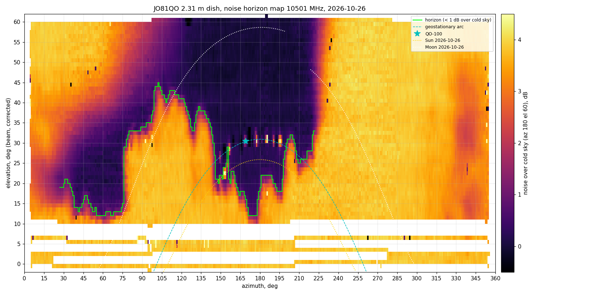

# Noise horizon scan, 2026-10-26

These are raw data from a noise scan of the 2.31 m dish at JO81QO. RX2 was tuned to 10501 MHz at 1500 kS/s
with `vgx=HI agcms=100 agchold=2`, and the gain was held on cold sky at az 180, el 60.
The rotator swept az 5..355 at full speed, serpentine, one elevation row at a time.
`hscan.py` logged every RX2 sample from the AGC stream (UDP 9906) together with the rotator
position, which it polled about 5 times a second.

Noise over cold sky in dB is `20 log10(AGC2_ref / AGC2)`, because noise power goes as 1/AGC2².

## Files

Columns: `t` (unix time), `row` (commanded elevation, or `ref` for a cold-sky reference visit),
`az`, `el` (rotator reading), `agc2`, `pi`, `hold`.

| file | rows | el correction | notes |
|---|---|---|---|
| `hscan-2026-10-26.csv` | 0, 3, part of 6 | 0 | coarse rows. The stream stopped after 15 min because the client was off-net. |
| `hscan2-2026-10-26.csv` | 6, 10, 15, 20, 30, 45 | 0 | coarse rows, run on the station LAN |
| `hscan3-2026-10-26.csv` | 10..38, 1 deg steps | **+1.02** | made after a cable snag on the mast shifted the pointing and before `el_trim` was set |
| `hscan4-2026-10-26.csv` | part of 39 | 0 | stopped for a Sun measurement. Superseded by hscan5. |
| `hscan5-2026-10-26.csv` | 39..60, 1 deg steps | 0 | with `el_trim = +1.02` |

The el correction (beam el = rotator el + correction) comes from cross cuts on the QO-100 beacon.
The beam shape did not change, so the shift was in the pointing and not in the feed.

The map uses a reference interpolated in time between each file's `ref` visits. The samples go into
1×1 degree cells by measured (corrected) el and az, and each cell shows its median.
The horizon line is the lowest el where the cell and the two cells above it are all below 1 dB.

## Result

- Ground, and everything blocked, reads about 3.8–4 dB over cold sky.
- Clear sky to the south, az 145–222. Around az 175 it is clear from el ~12, at az 160–200 from el 16–22,
  and at az 200–222 from el 25–32. QO-100 (az 169.2, el 30.4) is well inside this window.
- E and SE, az 80–145, are blocked by trees up to el 33–45.
- NE, az 30–75, has a low gap at el 12–20 under the tree crowns, which get hot again higher up.
- W and N, az 225–360 and 0–25, are blocked by trees up to at least el 60. The edge at az ~222 is
  vertical.

The scan was made in late October, with the trees wet after rain. Leaf fall and the seasons will change it.
